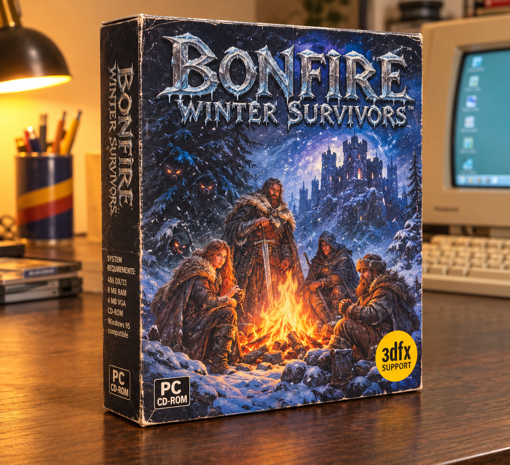

# BONFIRE: WINTER SURVIVORS



*A party-based survival RPG for PC CD-ROM — Winter 1996*

> **Concept mockup.** No real 1996 game by this name exists; this README is
> written as if the box above were a real release. The nearest real precedent
> is *The Bonfire: Forsaken Lands* (1997), which likewise has you holding a
> snowy camp against monsters at night.

---

## The pitch

Four survivors. One frozen valley. A castle on the hill that is lit every
night — and something in the treeline with glowing eyes that only firelight
keeps back.

By day you split the party to gather wood, hunt, and scout toward the castle.
By night you defend the ring of light, and it hurts if someone didn't make it
back before dark.

**The bonfire is the whole game.** It is your health bar, your base, and your
clock. Its light radius is your safe zone. A big fire keeps everyone warm and
the beasts back, but it burns through wood and is visible from the castle. A
small fire is stealthy, but people freeze and the eyes creep closer.

## The party

| Hero | Role |
|---|---|
| The Swordsman | Holds the front of the ring of light at night |
| The Ranger | Red-haired scout; hunts, reads the treeline |
| The Hooded Rogue | Locks, traps, quiet knives |
| The Trapper | Fur-hatted; wood, snares, and the last blanket |

Four distinct heroes means party management, not a lone-hero power fantasy.
**"Survivors"** is in the title because attrition and permadeath are the
point — nobody is guaranteed to see the castle.

## Design pillars

1. **Fire as health bar, base, and clock.** The light radius is the safe
   zone. Fire size trades warmth and safety against wood consumption and
   visibility from the castle.
2. **A day/night rhythm with real tension.** Day is for splitting the party
   to gather, hunt, and scout. Night is for defending the ring of light — and
   for noticing who didn't come back before dark.
3. **Characters who matter as people.** Fireside conversations build bonds
   and grudges that affect morale and combat. Deciding who keeps watch, who
   eats, and who gets the last blanket should be the hard choices.
4. **Moving camp as the big gamble.** To reach the castle you must abandon a
   safe fire and carry embers through the dark to light a new one, with a
   dying torch as your timer.
5. **Short and replayable.** A 10–12 hour campaign with randomized events and
   permadeath, so every run produces a different story.

## System requirements (as printed on the box spine)

- 486 DX/33
- 8 MB RAM
- 4 MB VGA
- CD-ROM
- Windows 95 compatible
- 3dfx support

> Fun tell: a 486 DX/33 with a 3dfx card never really went together. The box
> is a mockup — the anachronism is part of the charm.

## Contemporary press *(mock reviews, 1996–97)*

### PC Gamer — **9/10** — January 1997

> "Bonfire: Winter Survivors is the rare RPG in which every system points at a
> single idea: the fire. Your light radius is your safe zone; your warmth, your
> morale, and your life expectancy all burn down with the woodpile. I have
> played a hundred games where the campfire is a menu screen. Here it is the
> game."
>
> "By day you split your four survivors between the woodline, the hunt, and
> the scout toward the castle on the hill. By night the eyes come, and the ring
> of light is the only thing between them and your people. When the ranger
> doesn't make it back before dark, the empty space at the fire is the saddest
> thing I've seen in a game this year."
>
> "The graphics and sound are charming and best-in-class for the era — the
> pre-rendered isometric sprites and the tracker soundtrack set a standard
> other studios will be chasing for years."
>
> **The last word:** "One idea, tied through everything. Docked the final point
> because inventory management is fiddly to a fault, and because the castle
> sequence spikes so brutally in difficulty that it feels like a different,
> crueler game. 9/10."

### Computer Gaming World — **4.5 / 5** — December 1996

> "A survival RPG that understands warmth is a resource as precious as health.
> The fireside conversations build bonds and grudges that genuinely change how
> your party fights. Not for the faint of heart — permadeath is permanent —
> but the ten-hour campaign earns every ember."

### PC Zone — **92%** — Christmas 1996

> "Carrying embers through the dark with a dying torch as your timer is the
> most tense traversal I've played all year. Buy it for the fire. Stay for the
> people."

### Edge — **8/10** — November 1996

> "Brutal, beautiful, and built around one perfect light source. The castle
> finale will break you. That's rather the point."

### Letters to the editor

> "My swordsman froze to death because I fed the rogue twice. 10/10, would
> read the manual again." — K. Marsh, Toledo

---

## Install & play (1996 edition)

```
C:\> D:
D:\> SETUP.EXE          rem installs to C:\BONFIRE
C:\BONFIRE> BONFIRE.EXE
```

## About this repo

This repository is a **concept mockup** for the box above — there is no 1996
original to play. It currently contains:

- `images/cover-image.png` — the box art
- `IMPLEMENTATION_PLAN.md` — a concrete plan for actually building this game
  today

See [IMPLEMENTATION_PLAN.md](IMPLEMENTATION_PLAN.md) for engine choice, system
design, and milestones.
